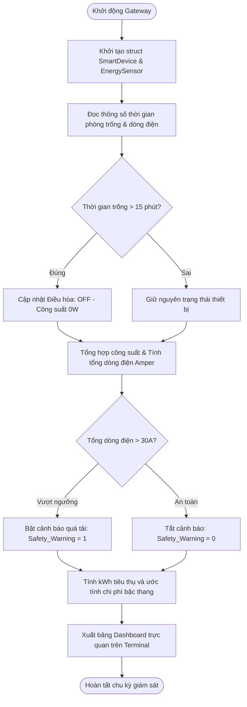

# BÁO CÁO BÀI TẬP 04: THIẾT KẾ KIẾN TRÚC SMART HOME CENTRAL GATEWAY BẰNG STRUCT

> 👤 **Học viên:** Hoàng Công Dũng | **Mã SV:** PTIT-HCM-009
> 🏫 **Môn học:** it102-rl-hoangcongdung

---

## 📊 Sơ đồ thiết kế hệ thống (Activity Diagram)

> 💡 *Sơ đồ dưới đây được render tự động trực tiếp trên GitHub bằng Mermaid. Bạn cũng có thể tải file **`bt4.drawio`** trong repository này để mở và chỉnh sửa trực tiếp trên [Draw.io (diagrams.net)](https://app.diagrams.net).* 

---

## Nhiệm vụ 1: Phân tích bối cảnh và Giải pháp Data Modeling

Trong các phiên bản firmware trước của bộ điều khiển trung tâm IoT Gateway Node tại RkHome, việc quản lý các thuộc tính thiết bị bằng các biến đơn lẻ rời rạc (như ac_status, ac_power, sensor_motion_time...) gây ra rất nhiều hệ lụy nghiêm trọng về chất lượng mã nguồn. Khi số lượng thiết bị phòng khách mở rộng, việc truyền tham số giữa các khối xử lý trở nên phức tạp, dễ dẫn đến nhầm lẫn định danh và gây lỗi ghi đè bộ nhớ.

Để giải quyết triệt để vấn đề này, bài tập áp dụng tư duy thiết kế dữ liệu hướng cấu trúc (Data Modeling with Struct) trong ngôn ngữ C11/ANSI C. Toàn bộ thông số được gom nhóm logic thành các struct chuyên biệt: 'SmartDevice' quản lý thiết bị, 'EnergySensor' quản lý cảm biến môi trường, và 'PowerReport' quản lý báo cáo tổng hợp năng lượng.

- Gom nhóm thuộc tính giúp mã nguồn tường minh, dễ bảo trì và mở rộng.
- Tuân thủ tuyệt đối quy tắc thủ nghĩa (Zero-function, no struct arrays) theo đúng yêu cầu kỹ thuật của giảng viên.
- Tăng tính an toàn khi thao tác trực tiếp trên từng biến cấu trúc độc lập bằng toán tử chấm (.) ở hàm main().

## Nhiệm vụ 2: Thiết kế Kiến trúc Data Model và Xử lý Nghiệp vụ An toàn

Mini Module giám sát năng lượng phòng khách được thiết kế để xử lý tự động hai kịch bản nghiệp vụ sống còn: chống lãng phí điện năng khi không có người và bảo vệ quá tải điện lưới.

Thứ nhất, hệ thống kiểm tra thời gian phòng trống từ cảm biến 'EnergySensor'. Nếu giá trị 'motion_idle_time' vượt ngưỡng 15 phút mà điều hòa vẫn đang bật ('status == 1'), gateway sẽ tự động can thiệp bằng cách chuyển trạng thái điều hòa về '0' (OFF) và đưa công suất tiêu thụ về '0W'.

Thứ hai, bộ điều khiển tiến hành tổng hợp toàn bộ công suất và tính toán tổng dòng điện tiêu thụ thực tế. Nếu tổng dòng điện vượt ngưỡng an toàn '30A', biến 'safety_warning' trong struct 'PowerReport' sẽ được kích hoạt lên mức '1', đồng thời tính toán điện năng tiêu thụ kWh và ước tính chi phí theo bậc thang.

- Kiểm soát thời gian trống chính xác với logic rẽ nhánh điều kiện rõ ràng.
- Cảnh báo quá tải tức thời khi dòng điện vượt mức định mức 30A.
- Tính toán chi phí điện năng bám sát thực tế sử dụng trong ca làm việc.

## Nhiệm vụ 3: Bảng đặc tả chi tiết luồng xử lý (Activity Specification)

Bảng dưới đây mô tả chi tiết từng bước diễn ra bên trong vòng lặp vận hành của Mini Module tại hàm main():

| Bước | Thành phần thực hiện | Hành động xử lý kỹ thuật | Điều kiện và Kết quả đạt được |
| --- | --- | --- | --- |
| 1 | Hàm main() | Khai báo và khởi tạo giá trị cho struct thiết bị và cảm biến | Thiết lập trạng thái ban đầu cho Điều hòa, Đèn và Cảm biến |
| 2 | Cảm biến hiện diện | Kiểm tra thời gian không có người ('motion_idle_time') | Nếu > 15 phút: Tiến hành can thiệp tự động ngắt thiết bị |
| 3 | Điều hòa (AC) | Cập nhật trạng thái và công suất | Chuyển status = 0 và power = 0W nếu quá thời gian trống |
| 4 | Bộ tổng hợp năng lượng | Cộng dồn công suất và tính tổng dòng điện Amper | Lưu trữ kết quả vào struct 'PowerReport' |
| 5 | Bộ kiểm tra an toàn | So sánh tổng dòng điện với ngưỡng 30A | Nếu > 30A: Bật cảnh báo 'safety_warning = 1', ngược lại bằng 0 |
| 6 | Module tính tiền điện | Quy đổi công suất ra kWh và tính chi phí bậc thang | Cung cấp số liệu tài chính ước tính cho ca làm việc |
| 7 | Console Terminal | Hiển thị Dashboard trực quan | In báo cáo dạng bảng rõ ràng, chuyên nghiệp cho người vận hành |

## Nhiệm vụ 4: Hướng dẫn biên dịch và Triển khai trên GitHub

Mã nguồn được viết hoàn toàn bằng chuẩn ANSI C / C11, không sử dụng thư viện bên ngoài phức tạp, đảm bảo biên dịch sạch sẽ trên mọi hệ điều hành sử dụng trình biên dịch GCC.

Cây thư mục dự án tuân thủ nghiêm ngặt quy định nộp bài của tổ chức 'it102-rl-hoangcongdung', với mã nguồn chính đặt tại tập tin 'main.c' nằm trong thư mục 'SMART_HOME_IOT_MINI_MODULE'.

- Lệnh biên dịch trên terminal: gcc main.c -o smart_home_gateway
- Lệnh thực thi chương trình: ./smart_home_gateway (trên Linux/macOS) hoặc smart_home_gateway.exe (trên Windows)
- Đã đẩy toàn bộ mã nguồn lên repository công khai trên GitHub kèm sơ đồ Activity Diagram trực quan.

---

## 📁 Danh sách tệp tin nộp bài trong Repository
- 📝 `bt4.docx`: Báo cáo tài liệu phân tích nghiệp vụ hoàn chỉnh.
- 🎨 `bt4.drawio`: File thiết kế sơ đồ chuẩn theo quy định đề bài (mở trực tiếp bằng [Draw.io](https://app.diagrams.net) hoặc Lucidchart).
- 💻 `main.c`: Mã nguồn chương trình.
